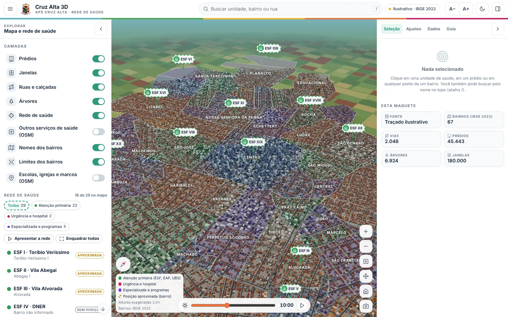
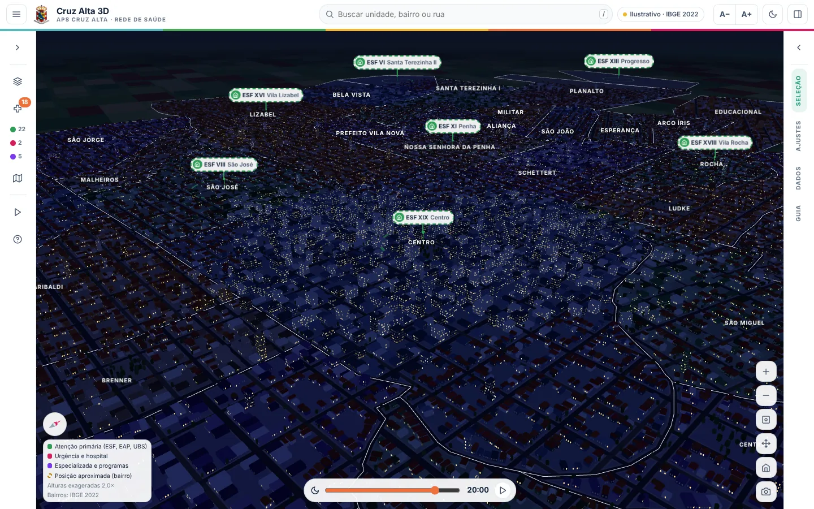
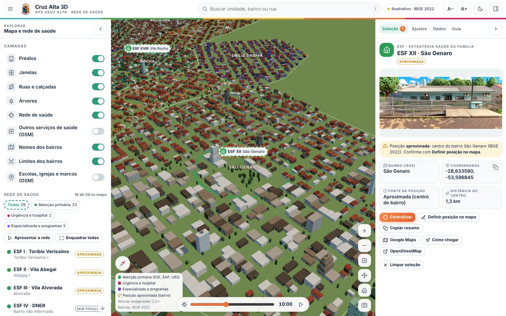
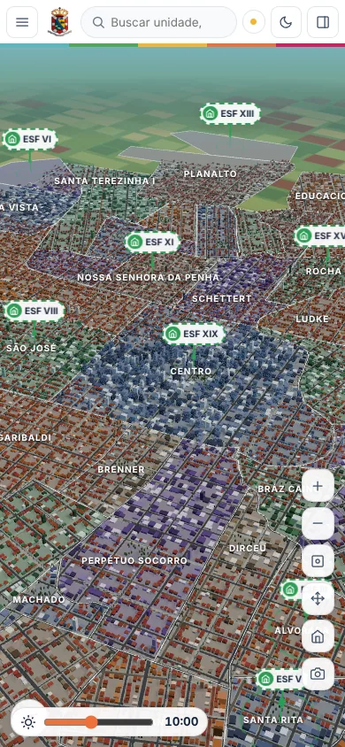

# Cruz Alta 3D · APS Cruz Alta

Maquete voxel de Cruz Alta (RS), no estilo da "cidade procedural" em three.js, feita para a rede de saúde do município. Ela usa:

- os **67 bairros oficiais do IBGE (Censo 2022)**: limites, nomes e códigos, que são sempre reais;
- **ruas, prédios, praças, água e ferrovia do OpenStreetMap**, baixados quando a página abre (com cópia local e no servidor);
- a **rede de saúde municipal** (ESF, EAP, UBS, UPA, HSVP, CEM, Farmácia Municipal, 60+, Ser Mulher), com as imagens deste repositório.

Sem acesso ao OpenStreetMap, a página monta um **traçado ilustrativo dentro dos bairros reais** e avisa isso na tela.

| Vista inicial | Noite (20h) |
|---|---|
|  |  |

| Unidade selecionada | Celular |
|---|---|
|  |  |

As prévias mostram o traçado ilustrativo. Com o OpenStreetMap carregado, as ruas e os prédios passam a ser os reais.

## Arquivos

| Arquivo | Para que serve |
|---|---|
| `Index.html` | O aplicativo inteiro (HTML, CSS e JavaScript). Funciona aberto direto no navegador ou dentro do Apps Script. |
| `Código.gs` | Servidor no Apps Script: publica a página, cria a planilha da rede, grava posições com PIN e guarda o mapa no Drive. |
| `previa-*.webp` | Capturas de tela usadas neste README. |

## Como publicar (Apps Script + Google Sites)

1. Em script.google.com, crie um projeto. Cole o `Código.gs` e crie um arquivo HTML chamado `Index` com o conteúdo de `Index.html`.
2. Rode a função `configurarSistema` uma vez e autorize. Ela cria a pasta **Cruz Alta 3D · Dados do mapa** no Drive, a planilha **Cruz Alta 3D · Rede de Saúde (base de dados)** e já tenta baixar o mapa do OpenStreetMap para o servidor.
3. Na planilha, aba **Configuração**, defina o **PIN de edição**. Sem PIN, a gravação pelo site fica bloqueada.
4. Vá em **Implantar > Nova implantação > App da Web**, com *Executar como: eu* e *Quem pode acessar: qualquer pessoa*.
5. No Google Sites, use **Inserir > Incorporar > URL** com o endereço do app.

Se preferir o script vinculado à planilha (Extensões > Apps Script), ele usa a própria planilha e cria o menu **Cruz Alta 3D**.

### Atalhos na URL

| Parâmetro | Efeito |
|---|---|
| `?unidade=esf-19` | Abre focado na ESF XIX (vale qualquer ID da planilha) |
| `?bairro=Centro` | Abre com o bairro selecionado |
| `?hora=19` | Hora do dia simulada (sol, sombras e janelas acesas) |
| `?painel=0` | Abre com os painéis recolhidos, bom para capa de site |
| `?modo=ilustrativo` | Não tenta baixar o mapa real |

## De onde vêm os dados

O mapa é procurado nesta ordem, e o chip no topo mostra qual fonte está em uso:

1. cópia salva no navegador (IndexedDB);
2. cópia salva no servidor (Drive, pelo Apps Script);
3. retrato publicado neste repositório em `cruzalta-3d/dados-osm-cruzalta.json`;
4. download do OpenStreetMap (Overpass), primeiro pelo servidor e depois pelo navegador;
5. traçado ilustrativo, se nada acima funcionar.

Para todo mundo abrir já com o mapa real, sem depender do Overpass: na aba **Dados**, use **Exportar dados da cidade (JSON)** e suba o arquivo para esta pasta com o nome `dados-osm-cruzalta.json`. Se o Overpass estiver bloqueado na rede, a mesma aba tem **Copiar consulta Overpass**: rode a consulta em overpass-turbo.eu, exporte em JSON e use **Importar JSON**.

Os polígonos dos bairros vieram do arquivo `com_mapa.html` enviado, que contém a malha oficial do IBGE. **Só os limites e nomes dos bairros foram usados.** O conteúdo eleitoral do arquivo foi descartado, porque um sistema da Secretaria de Saúde precisa ser imparcial.

## Rede de saúde no mapa

- **Exata**: coordenada da planilha ou unidade encontrada no OpenStreetMap pelo nome (ex.: "ESF Centro").
- **Aproximada**: centro do bairro de referência. O pino fica tracejado e aparece um anel no chão.
- **Sem posição**: aparece na lista, mas não no mapa (DNER, Vila Nova, Benjamin Nott, Vida Nova, UPA, HSVP, CEM, Curativos, Farmácia, 60+ e Ser Mulher, até receberem coordenada).

Há três jeitos de corrigir as posições:

1. **Pelo mapa**: selecione a unidade, clique em *Definir posição no mapa*, clique no ponto exato e informe o PIN. A coordenada vai para a planilha.
2. **Pela planilha**: preencha Latitude e Longitude. A validação só aceita coordenadas de Cruz Alta.
3. **Pelo endereço**: preencha Endereço e use *Geocodificar endereços* (aba Dados, com PIN, ou o menu da planilha vinculada).

## Planilha criada automaticamente

- **Unidades**: ID, sigla, nome, tipo, bairro (lista dos 67 bairros do IBGE), endereço, telefone, latitude, longitude, fonte da posição, imagem, ativo, observações, data e usuário da última alteração. Tem cabeçalho congelado, filtro, faixas alternadas, ID repetido em vermelho, coordenada faltante em amarelo e inativos em cinza.
- **Configuração**: PIN de edição, ajustes padrão do site e validade da cópia do mapa (30 dias).
- **Log**: registro automático de ações e erros (últimas 3.000 linhas).
- **Instruções**: o passo a passo de uso.

O PIN é conferido só no servidor, nunca vai para o navegador e bloqueia por 10 minutos depois de oito tentativas erradas. Nenhum dado de paciente é usado.

## O que dá para ajustar na tela (aba Ajustes)

São as mesmas pastas do painel original, em português: semente, cores por bairro, céu (hora, data com a posição real do sol em Cruz Alta, animação do dia e sombras), arquitetura (exagero vertical, alturas, recuos, lotes vazios, telhados cerâmicos), malha urbana, lotes e calçadas, planejamento (densidades e raio do centro), praças e árvores, janelas e qualidade gráfica. Os ajustes ficam salvos no navegador. Com PIN, o botão **Salvar como padrão do sistema** grava os ajustes atuais como padrão para quem abrir o site pela primeira vez.

## Testes feitos antes da entrega

- Chromium sem placa de vídeo (WebGL por software) em 1440×900, 1024×768 e 390×844, nos temas claro e escuro, com painéis abertos, recolhidos e em gaveta.
- Caminho OpenStreetMap com dados sintéticos no formato do Overpass: ruas, prédios (inclusive em L e multipolígono), praça, arroio, ferrovia e serviços de saúde. Foi conferido o reconhecimento de ESF Centro, UBS Vida Nova, HSVP e Farmácia Municipal, e a cópia local reaproveitada ao recarregar.
- `Código.gs` executado contra serviços do Google simulados em memória (33 verificações): criação única da planilha, PIN obrigatório com bloqueio, gravação sem duplicar linha, padrão saneado, cache compactado íntegro, reserva entre servidores Overpass, trava de 10 minutos, geocodificação e log.
- Integração página com servidor (`google.script.run` ligado ao `Código.gs` simulado): leitura da planilha, mapa vindo do Drive, posição definida no clique e gravada na planilha com PIN, e padrão do sistema salvo.
- Embutido em iframe como no Google Sites (16 verificações): altura estável, nenhuma rolagem vazando para a página-mãe (roda, toque e teclado) e A−/A+ sem faixa sobrando.
- Nenhum erro de console, nenhum emoji na interface e contraste de 14:1 nos títulos no tema escuro.

**Não testado aqui:** o download real do OpenStreetMap (a rede deste ambiente bloqueia o Overpass) e a execução no Apps Script de verdade. Os dois foram exercitados apenas com dados e serviços simulados.

## Créditos e licenças

- Bairros: Malha de Bairros do IBGE, Censo Demográfico 2022.
- Ruas, prédios e serviços: © colaboradores do OpenStreetMap, licença ODbL (openstreetmap.org/copyright).
- Motor 3D: three.js r147 (MIT), carregado de cdn.jsdelivr.net, com unpkg.com como reserva.
- Ideia visual: cidade voxel procedural em React/three.js (código transcrito do vídeo), reescrita em JavaScript puro para o Apps Script.
- Imagens das unidades: acervo da Secretaria Municipal de Saúde de Cruz Alta (este repositório).
